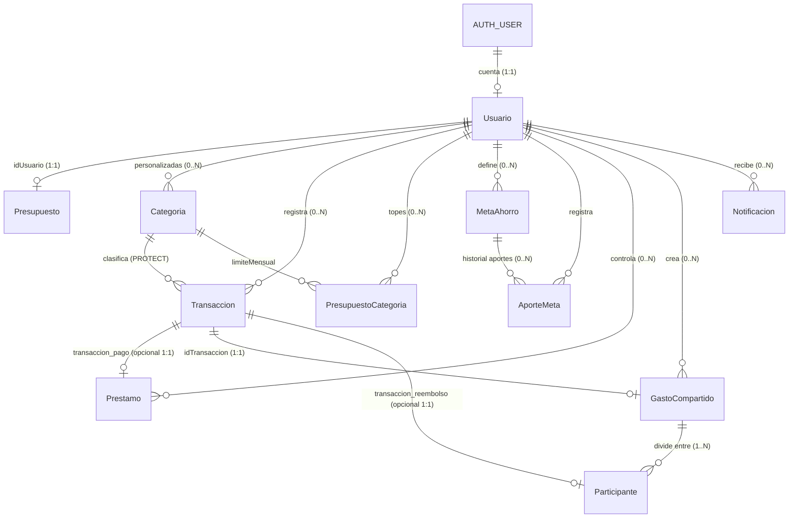

# Arquitectura y Base de Datos Real Implementada — Mishi

**Proyecto:** Mishi (Control de Gastos Personales para Estudiantes Universitarios)  
**Versión documentada:** Entrega Final — Fases 1, 2 y 3 completadas  
**Fecha:** 25 de noviembre de 2026

> **Nota de trazabilidad:** El documento previo [arquitectura-sistema-mishi.md](arquitectura-sistema-mishi.md) correspondió al diseño inicial de la Clase 4 (propuesta REST/JWT v1.0). Este documento refleja la **arquitectura real implementada** en el repositorio actual con Django 5.2 (MVT + capa de servicios de dominio), las 10 tablas activas y la secuencia de migraciones `0001` a `0012`.

---

## 1. Stack Tecnológico Real

- **Backend:** Python 3.11 + **Django 5.2.18** (arquitectura MVT con capa de servicios desacoplada).
- **Base de datos:** ORM de Django compatible con **SQLite** (entorno local de desarrollo/evaluación mediante `local_settings.py`) y **MySQL 8** vía `PyMySQL 1.1.1` (configurable en `.env`).
- **Frontend:** Plantillas Django HTML5 semánticas, CSS nativo modular (`static/css/styles.css`, enfoque Mobile-First desde `360 px` hasta escritorio `1440 px`), JavaScript vanilla (`static/js/mishi-pickers.js` para calendarios y selectores personalizados) y **Chart.js** local (`static/js/chart.umd.min.js`).
- **Pruebas automatizadas:** `pytest 9.2.0` + `pytest-django 4.14.0` (**58 pruebas activas**).

---

## 2. Arquitectura Modular en Capas (Implementación Real)

```mermaid
flowchart TB
    subgraph Presentacion["Capa 1: Presentación (Templates Django + CSS + JS)"]
        T_Pub["Públicas: landing.html, login.html, registro_usuario.html, privacidad.html"]
        T_App["Panel /app/: dashboard, historial, detalle, editar, categorias, insights, metas, crear_meta, presupuestos, notificaciones, perfil"]
        JS_UI["static/js/mishi-pickers.js + Chart.js local + Bottom Sheets globales"]
    end

    subgraph Controladores["Capa 2: Controladores HTTP y Seguridad"]
        Urls["finanzas/urls.py + mishi_project/urls.py"]
        Views["finanzas/views.py (@login_required, POST+CSRF, aislamiento por perfil)"]
        CP["finanzas/context_processors.py (bottom sheet, avatares, conteo liviano)"]
    end

    subgraph Servicios["Capa 3: Servicios de Dominio (finanzas/services/)"]
        S_Fin["finanzas_service.py (Saldo, Ciclos, Límite Diario, RF-05, RF-09)"]
        S_Cat["categorias_service.py (RF-02)"]
        S_Met["metas_service.py (RF-10)"]
        S_Pre["presupuestos_service.py (RF-11)"]
        S_Com["compartidos_service.py (RF-12)"]
        S_Ana["analitica_service.py (RF-08)"]
        S_Rec["recomendaciones_service.py (RF-13)"]
        S_Not["notificaciones_service.py (Alertas In-App)"]
        S_Seg["seguridad_service.py (Contraseñas y Privacidad)"]
        S_Ava["avatares.py (15 avatares Mishi)"]
    end

    subgraph Persistencia["Capa 4: Persistencia (Django ORM + SGBD Relacional)"]
        Models["finanzas/models.py (10 tablas de dominio + auth_user)"]
        DB[("SQLite local / MySQL (.env)")]
    end

    Presentacion <--> Controladores
    Controladores --> Servicios
    Servicios --> Models
    Models <--> DB
```

### Principios contables y de seguridad garantizados

1. **Fuente única de verdad financiera (`finanzas_service.py`):**
   - `saldo_total = saldo_inicial + ingresos_recibidos - gastos_totales`
   - `saldo_disponible = saldo_total - dinero_reservado_metas`
   - `base_disponible_hoy = saldo_inicio_dia + ingresos_hoy` (un gasto de hoy no encoge doblemente el límite diario del mismo día).
2. **Cero doble contabilización:**
   - **Metas (`AporteMeta`):** reservar dinero incrementa `MetaAhorro.acumulado` y registra `AporteMeta` sin crear un `Transaccion(tipo='gasto')` duplicado.
   - **Gastos compartidos (`GastoCompartido` + `Participante`):** si el estudiante paga la cuenta total se registra 1 gasto; cada participante marcado como pagado crea 1 solo ingreso idempotente vinculado por `transaccion_reembolso`. Si pagó otra persona, solo se descuenta `mi_parte`.
   - **Préstamos (`Prestamo`):** seguimiento separado; la liquidación en saldo es opcional, 1-a-1 (`transaccion_pago`) e idempotente.
3. **Aislamiento estricto y seguridad:**
   - Todas las consultas y mutaciones filtran por `idUsuario=perfil`.
   - Validación de contraseñas en servidor (`AUTH_PASSWORD_VALIDATORS`), CSRF en toda mutación `POST`, cookies `HttpOnly` / `SameSite=Lax`, protección anti open-redirect (`next` limitado a `/app/`) y rechazo de configuración insegura en producción (`validar_configuracion_produccion()`).
4. **Rendimiento en notificaciones:**
   - Navegación normal (`GET`) ejecuta 1 sola consulta indexada `COUNT(*)` (`idx_notif_usr_desc_leida`). La sincronización completa corre al abrir `/app/notificaciones/`, al iniciar el día en sesión o tras mutaciones `POST`. Descarte lógico (`descartada=True`) impide reaparición de avisos eliminados.

---

## 3. Modelo Relacional Real de Base de Datos

### Diagrama Entidad-Relación

### Catálogo de tablas implementadas (`finanzas/models.py`)

| Tabla (`db_table`) | Propósito | Campos clave |
| :--- | :--- | :--- |
| `Usuario` | Perfil financiero, preferencias, avatar, umbral hormiga y consentimiento | `idUsuario` (PK), `cuenta_id` (1:1 `auth_user`), `nombre`, `universidad`, `frecuencia`, `mesada`, `saldo_inicial`, `fecha_proximo_ingreso`, `dia_pago_mensual`, `avatar`, `ocultar_saldo`, `alertas_activas`, `tema_visual`, `umbral_hormiga`, `acepto_politica_datos`, `fecha_aceptacion_datos`, `version_politica_datos` |
| `Categoria` | Categorías globales (`idUsuario=NULL`) y personalizadas por usuario | `idCategoria` (PK), `nombre`, `idUsuario` (FK nullable), `es_personalizada`, `tipo_aplicable`, `tono`; índice `idx_cat_usuario_nombre` |
| `Transaccion` | Registro de ingresos y gastos con precisión `Decimal(10,2)` | `idTransaccion` (PK), `idUsuario` (FK), `idCategoria` (FK `PROTECT`), `monto`, `fecha`, `tipo`, `descripcion` |
| `Presupuesto` | Límites generales diario y mensual del usuario | `idPresupuesto` (PK), `idUsuario` (1:1), `limiteDiario`, `limiteMensual` |
| `Presupuesto_Categoria` | Topes mensuales reales por categoría (`RF-11`) | `idPresupuestoCat` (PK), `idUsuario` (FK), `idCategoria` (FK), `limiteMensual`, `actualizado_en`; restricción única `(idUsuario, idCategoria)` |
| `Meta_Ahorro` | Metas de ahorro con fecha objetivo (`RF-10`) | `idMeta` (PK), `idUsuario` (FK), `nombre`, `categoria`, `objetivo`, `acumulado`, `fecha_objetivo`, `creada_en` |
| `Aporte_Meta` | Historial fechado de abonos a metas (`RF-08`, `RF-10`) | `idAporte` (PK), `idMeta` (FK), `idUsuario` (FK), `monto`, `fecha`, `nota`; índice `idx_aporte_usr_fecha` |
| `Prestamo` | Préstamos por cobrar/pagar con plazo y liquidación opcional (`RF-12`) | `idPrestamo` (PK), `idUsuario` (FK), `deudor`, `concepto`, `fecha`, `fecha_limite`, `fecha_pago`, `tipo`, `monto`, `estado`, `transaccion_pago` (1:1 nullable) |
| `GastoCompartido` | Cuenta grupal ligada a 1 transacción (`RF-12`) | `idGastoComp` (PK), `idUsuario` (FK), `idTransaccion` (1:1), `descripcion`, `montoTotal`, `mi_parte`, `yo_pague_total`, `estado`, `creado_en` |
| `Participante` | Aportes individuales y reembolso idempotente (`RF-12`) | `idParticipante` (PK), `idGastoComp` (FK), `nombreAmigo`, `parteAportada`, `pagado`, `fecha_pago`, `transaccion_reembolso` (1:1 nullable) |
| `Notificacion` | Avisos in-app persistentes con descarte lógico (`RF-05`) | `idNotificacion` (PK), `idUsuario` (FK), `clave`, `tipo`, `nivel`, `titulo`, `mensaje`, `url_destino`, `leida`, `descartada`, `creada_en`; índices `idx_notif_usr_leida`, `idx_notif_usr_clave`, `idx_notif_usr_desc_leida` |

---

## 4. Historial de Migraciones Independientes (`finanzas/migrations/`)

1. `0001_initial` a `0004_usuario_cuenta_usuario_frecuencia_usuario_universidad`: esquema base inicial y vínculo con `auth_user`.
2. `0005_motor_financiero`: separación contable `saldo_inicial`, `fecha_proximo_ingreso`, `dia_pago_mensual` y reconciliación segura.
3. `0006_avatares_y_personalizacion`: `avatar` (15 avatares Mishi) y preferencias persistentes (`ocultar_saldo`, `alertas_activas`, `tema_visual`).
4. `0007_notificaciones`: creación de tabla `Notificacion` con índices de lectura/deduplicación.
5. `0008_seguridad_privacidad_y_notif_descartada`: consentimiento versionado Ley 1581 y descarte lógico `descartada` + índice compuesto.
6. `0009_categorias_personalizadas_y_umbral_hormiga`: `Usuario.umbral_hormiga` y categorías personalizadas por usuario (`RF-02`, `RF-09`).
7. `0010_metas_fecha_objetivo_y_aportes`: `MetaAhorro.fecha_objetivo` y tabla `AporteMeta` (`RF-10`, `RF-08`).
8. `0011_presupuestos_por_categoria`: tabla `PresupuestoCategoria` (`RF-11`).
9. `0012_prestamos_y_gastos_compartidos`: plazos, liquidación y reembolsos idempotentes en `Prestamo`, `GastoCompartido` y `Participante` (`RF-12`).
