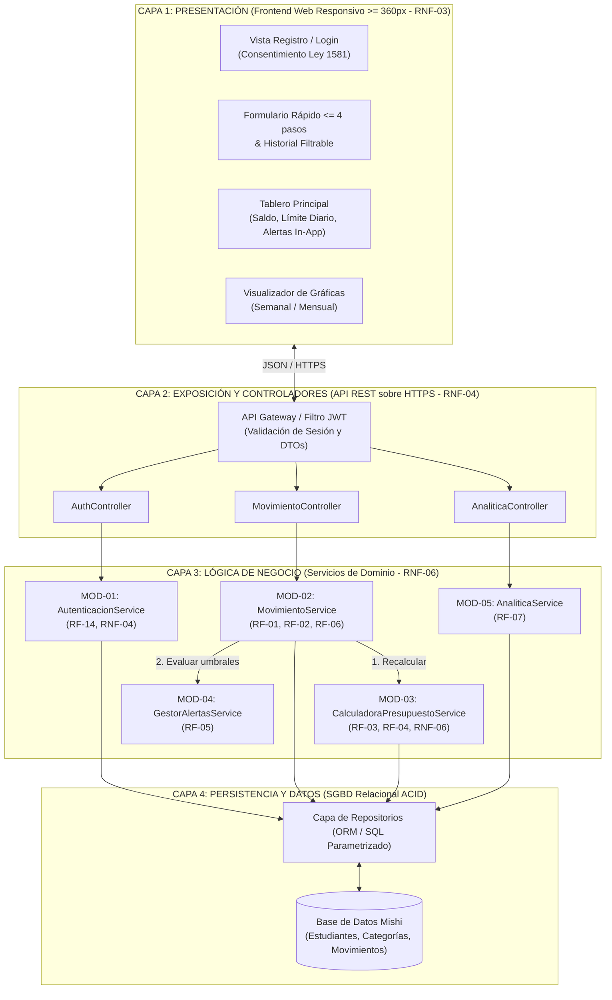
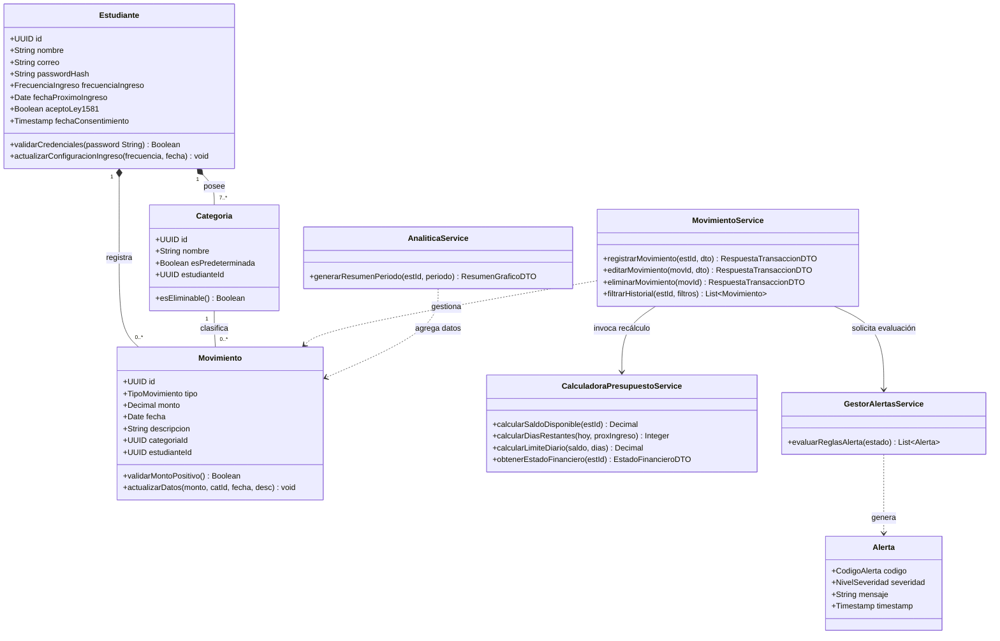
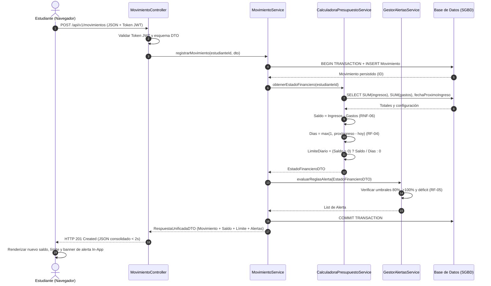

## CORPORACIÓN UNIVERSITARIA RAFAEL NÚÑEZ

*Asignatura*

**DISEÑO DE SOFTWARE**

---

## Entregable · Clase 4: Definir la arquitectura

# MISHI

### Aplicación de control de gastos personales para estudiantes universitarios

---

*Presentado a:*

**Maybelline Castro**

*Presentado por:*

**Melvis Morales**

**Karla Amaranto**

**Isabel Álvarez**

**Harrinson Bonilla**

**Cartagena, Colombia**

**2026**

---

# Introducción

El presente documento define la arquitectura de software de **Mishi (v1.0)**, una aplicación web responsiva orientada al control de gastos personales de estudiantes universitarios. A partir de las necesidades, requisitos funcionales (RF-01 a RF-14) y requisitos no funcionales (RNF-01 a RNF-06) establecidos en el Entregable 2: Especificar necesidades, este documento establece la estructura lógica en capas, la descomposición modular del prototipo, las responsabilidades técnicas del sistema y del equipo de desarrollo, las clases críticas del dominio, los flujos de comunicación, los patrones arquitectónicos seleccionados, las decisiones técnicas (ADR) y el análisis de riesgos.

El diseño arquitectónico responde directamente al alcance delimitado para la primera versión funcional (prototipo v1.0), priorizando los requisitos de prioridad alta (RF-01, RF-02, RF-03, RF-04, RF-05, RF-06, RF-14) junto con el módulo de resumen gráfico (RF-07), y asegurando el cumplimiento de los atributos críticos de calidad: usabilidad (RNF-01), rendimiento en redes móviles (RNF-02), compatibilidad multiplataforma (RNF-03), seguridad y cumplimiento de la Ley 1581 de 2012 (RNF-04), disponibilidad (RNF-05) y exactitud matemática del 100% (RNF-06).

# 1. Arquitectura General y Estructura Modular

Para garantizar la separación estricta de responsabilidades (Separation of Concerns), bajo acoplamiento y alta cohesión, la arquitectura de Mishi se estructura combinando un modelo lógico de 4 capas con una descomposición funcional en 5 módulos cohesivos.

## 1.1. Estructura en Capas (Vista Lógica)

El sistema implementa una **Arquitectura en Capas Estándar (Layered Architecture)** con flujo de dependencias unidireccional descendente (cada capa consume exclusivamente las interfaces expuestas por la capa inmediatamente inferior):

### 1. Capa de Presentación (Presentation Layer / Frontend Web Responsivo)

- **Alcance técnico:** interfaz gráfica de usuario (UI) construida bajo enfoque Mobile-First con soporte desde 360 px de ancho en navegadores Chrome y Safari (RNF-03).

- **Función estructural:** gestiona el renderizado de vistas, la captura de eventos del estudiante, las validaciones sintácticas locales en el cliente (campos obligatorios, tipos numéricos, formato de fecha) y el despliegue visual del saldo disponible, el límite diario, las alertas internas (In-App) y los gráficos estadísticos.

### 2. Capa de Exposición y Controladores (API Gateway & Controllers Layer)

- **Alcance técnico:** interfaz de programación de aplicaciones bajo estilo REST sobre protocolo seguro HTTPS/TLS (RNF-04), con intercambio de cargas útiles en formato JSON.

- **Función estructural:** actúa como frontera del servidor. Orquesta la recepción de peticiones HTTP, valida tokens de autenticación/sesión (RF-14), deserializa y valida los Data Transfer Objects (DTOs) de entrada, enruta hacia los servicios de negocio correspondientes y estandariza los códigos de respuesta HTTP (200, 201, 400, 401, 404, 500).

### 3. Capa de Lógica de Negocio (Business Logic / Domain Layer)

- **Alcance técnico:** núcleo transaccional y algorítmico del sistema, completamente desacoplado de la interfaz gráfica y del motor de almacenamiento.

- **Función estructural:** implementa las reglas deterministas del dominio de Mishi: cálculo exacto del saldo disponible (RF-03) y del límite diario de gasto (RF-04), evaluación reactiva de umbrales de alerta (RF-05), agregación de métricas para reportes (RF-07) y garantías de precisión matemática al 100% (RNF-06).

### 4. Capa de Persistencia y Acceso a Datos (Data Access Layer / SGBD Relacional)

- **Alcance técnico:** repositorios de datos (Repository Pattern) y mapeo objeto-relacional conectados a un sistema gestor de bases de datos relacional (SGBD) con soporte transaccional ACID.

- **Función estructural:** abstrae las operaciones CRUD (Create, Read, Update, Delete) mediante consultas parametrizadas, garantiza la integridad referencial entre entidades (Estudiante, Categoria, Movimiento), asegura consistencia tras ediciones o eliminaciones (RF-06) y optimiza consultas mediante índices.

## 1.2. Descomposición Modular (Vista Funcional · Alcance v1.0)

| **Código** | **Nombre del Módulo**                            | **Requisitos Trazados** | **Justificación Arquitectónica y Alcance Técnico**                                                                                                                                                                                                                                                               |
|------------|--------------------------------------------------|-------------------------|------------------------------------------------------------------------------------------------------------------------------------------------------------------------------------------------------------------------------------------------------------------------------------------------------------------|
| MOD-01     | Gestión de Identidad, Acceso y Privacidad        | RF-14, RNF-04           | Encapsula el ciclo de vida de la cuenta del estudiante (registro, inicio de sesión, gestión de sesiones). Implementa el almacenamiento seguro de credenciales mediante hashing criptográfico y registra la autorización explícita para el tratamiento de datos personales conforme a la Ley 1581 de 2012.        |
| MOD-02     | Núcleo Transaccional de Movimientos y Categorías | RF-01, RF-02, RF-06     | Administra el registro ágil de ingresos y gastos (flujo optimizado a ≤ 4 pasos y < 15 s), la clasificación obligatoria en las 7 categorías base o en categorías personalizadas (mínimo 3 por usuario), y las operaciones de filtrado por fecha/categoría, edición y borrado en el historial.                    |
| MOD-03     | Motor de Cálculo Presupuestal                    | RF-03, RF-04, RNF-06    | Componente determinista dedicado al recálculo en tiempo real (< 2 s) del saldo disponible y del límite diario. Implementa la lógica condicional según la frecuencia de ingreso (diaria, semanal, quincenal, mensual) y protege la operación contra división por cero estableciendo un mínimo de 1 día restante. |
| MOD-04     | Sistema de Monitoreo y Alertas In-App            | RF-05                   | Subsistema reactivo basado en reglas de umbral que evalúa cada actualización transaccional para disparar notificaciones visuales dentro de la aplicación (< 5 s) ante tres estados: aproximación al límite diario (80%), exceso del límite (> 100%) y saldo insuficiente para los días restantes.              |
| MOD-05     | Analítica y Visualización Financiera             | RF-07, RNF-01           | Procesa y consolida series temporales y agrupaciones por categoría para periodos semanales o mensuales. Entrega estructuras de datos agregadas listas para renderizar gráficos comparativos de ingresos vs. gastos y distribución del consumo (< 3 s).                                                          |

**Nota de alcance:** los requisitos de prioridad media y baja (RF-08 a RF-13) quedan aislados como extensiones evolutivas futuras que se acoplarán sobre MOD-02 y MOD-03 sin alterar la estructura base.

## 1.3. Diagrama de Arquitectura en Capas y Módulos

*Figura 1. Vista lógica en capas y descomposición modular de Mishi v1.0.*

# 2. Descripción de Responsabilidades del Sistema y del Equipo

## 2.1. Responsabilidades por Capa Arquitectónica

### 1. Capa de Presentación (Frontend Web Responsivo)

- **Renderizado multiplataforma:** desplegar la interfaz adaptativa bajo enfoque Mobile-First desde 360 px de ancho en Chrome y Safari (RNF-03).

- **Captura y flujo ágil:** optimizar el registro de movimientos a máximo 4 pasos y menos de 15 segundos (RF-01, RNF-01).

- **Validación sintáctica en cliente:** verificar campos vacíos, formatos de fecha y montos positivos antes de emitir peticiones HTTP.

- **Visualización de estados y gráficos:** renderizar el saldo disponible, el límite diario, las alertas In-App, el historial filtrable y las gráficas semanales/mensuales.

- **Restricción de acoplamiento:** tiene prohibido ejecutar cálculos financieros críticos o acceder directamente a la base de datos; consume exclusivamente contratos REST/JSON.

### 2. Capa de Controladores / API (API REST)

- **Exposición segura:** publicar endpoints REST sobre HTTPS (RNF-04) con intercambio de datos en JSON.

- **Control de acceso:** interceptar peticiones para validar la vigencia del token de sesión (RF-14), rechazando solicitudes no autenticadas (HTTP 401).

- **Serialización y validación:** deserializar DTOs entrantes, validar esquemas y mapear resultados a códigos de estado HTTP estándar (200, 201, 400, 404).

- **Restricción de acoplamiento:** actúa estrictamente como adaptador HTTP; tiene prohibido contener lógica de negocio o consultas SQL/ORM.

### 3. Capa de Lógica de Negocio (Servicios de Dominio)

- **Ejecución de reglas financieras:** implementar de forma determinista el cálculo del saldo disponible (RF-03) y del límite diario (RF-04) con exactitud del 100% (RNF-06).

- **Orquestación transaccional:** coordinar flujos compuestos (guardar movimiento → recalcular saldo y límite → evaluar alertas).

- **Motor de alertas y analítica:** evaluar umbrales de gasto diario (RF-05) y consolidar métricas temporales para gráficas (RF-07).

- **Restricción de acoplamiento:** es agnóstica al protocolo HTTP y al motor de base de datos; opera sobre entidades de dominio e interfaces de repositorio.

### 4. Capa de Persistencia (Repositorios / SGBD Relacional)

- **Gestión atómica:** ejecutar operaciones CRUD parametrizadas (prevención de inyección SQL) bajo transacciones ACID (RF-06).

- **Integridad y rendimiento:** garantizar la integridad referencial entre entidades y mantener índices (estudiante_id, fecha, categoria_id) para filtrar lotes de 500 movimientos en menos de 2 segundos (RF-06).

- **Protección de datos en reposo:** almacenar contraseñas únicamente mediante hash criptográfico y auditar el consentimiento de la Ley 1581 de 2012 (RNF-04).

- **Restricción de acoplamiento:** no aplica reglas de negocio ni validaciones de sesión; solo ejecuta lectura y escritura atómica.

## 2.2. Contrato Detallado de Responsabilidades por Módulo Funcional

### MOD-01 · Gestión de Identidad, Acceso y Privacidad (RF-14, RNF-04)

- **Entradas:** correo electrónico, contraseña, nombre, frecuencia de ingreso (diaria, semanal, quincenal, mensual), fecha del próximo ingreso y aceptación explícita de tratamiento de datos.

- **Procesamiento:** validar la autorización de privacidad según la Ley 1581 de 2012; transformar contraseñas con hash criptográfico con salt; autenticar credenciales para recuperar el historial íntegro; e inicializar automáticamente las 7 categorías predeterminadas (RF-02).

- **Salidas:** token de sesión autenticado y perfil configurado del estudiante.

### MOD-02 · Núcleo Transaccional de Movimientos y Categorías (RF-01, RF-02, RF-06)

- **Entradas:** tipo (INGRESO/GASTO), monto, categoria_id, fecha, descripción, criterios de filtro (fecha_inicio, fecha_fin, categoria_id) y nombre de nueva categoría.

- **Procesamiento:** asegurar que el 100% de los movimientos posean categoría; permitir crear al menos 3 categorías personalizadas sin duplicados; persistir registros disparando MOD-03 y MOD-04; filtrar el historial de 500 movimientos en < 2 s; y procesar ediciones o eliminaciones actualizando saldo y límite.

- **Salidas:** comprobante de transacción y listado del historial filtrado.

### MOD-03 · Motor de Cálculo Presupuestal (RF-03, RF-04, RNF-06)

- **Entradas:** sumatoria de ingresos, sumatoria de gastos, frecuencia de ingreso y fecha del próximo ingreso.

- **Procesamiento:** aplicar con precisión decimal exacta las siguientes fórmulas:

*Saldo Disponible = Σ Ingresos − Σ Gastos (en < 2 s)*

*Días Restantes = máx(1, FechaPróximoIngreso − FechaActual) (evita la división entre cero)*

*Límite Diario = Saldo Disponible ÷ Días Restantes (0 si el saldo es ≤ 0, notificando déficit)*

- **Salidas:** estado financiero actualizado (saldoDisponible, limiteDiario, diasRestantes, totalGastadoHoy).

### MOD-04 · Sistema de Monitoreo y Alertas In-App (RF-05)

- **Entradas:** estado financiero generado por MOD-03.

- **Procesamiento:** evaluar tres condiciones tras cada movimiento: (1) alerta preventiva al alcanzar el 80% del límite diario; (2) alerta de exceso al superar el 100% del límite diario; y (3) alerta de saldo insuficiente cuando el saldo no alcanza para los días restantes. Entregar alertas en < 5 s.

- **Salidas:** colección de notificaciones visuales (tipoAlerta, severidad, mensaje).

### MOD-05 · Analítica y Visualización Financiera (RF-07, RNF-01)

- **Entradas:** identificador del estudiante y periodo seleccionado (SEMANAL o MENSUAL).

- **Procesamiento:** consolidar ingresos totales vs. gastos totales del periodo y agrupar egresos por categoría con su participación porcentual en < 3 s.

- **Salidas:** DTO estadístico estructurado para renderizado gráfico.

## 2.3. Matriz de Asignación de Responsabilidades del Equipo de Desarrollo

| **Integrante** | **Rol Técnico** | **Capas y Módulos Asignados** | **Responsabilidades Específicas de Implementación y Calidad** |
|---|---|---|---|
| Melvis Morales | Arquitecto Backend y Líder de Lógica de Negocio | • Capa de Lógica de Negocio • MOD-03 (Motor de Cálculo) • MOD-04 (Sistema de Alertas) | • Implementar las fórmulas exactas de saldo disponible (RF-03) y límite diario (RF-04) asegurando el 100% de exactitud (RNF-06). • Programar la lógica de evaluación de umbrales (80%, > 100% y déficit, RF-05). • Ejecutar pruebas unitarias de verificación matemática. |
| Karla Amaranto | Desarrolladora Frontend y Especialista UX/UI | • Capa de Presentación (Web Responsiva) • MOD-05 (Analítica y Gráficas) | • Desarrollar la interfaz Mobile-First compatible con Chrome y Safari desde 360 px (RNF-03). • Optimizar el flujo de registro a ≤ 4 pasos y < 15 segundos (RF-01, RNF-01). • Implementar las gráficas semanales y mensuales (RF-07). |
| Isabel Álvarez | Ingeniera de Datos y Seguridad | • Capa de Persistencia (SGBD) • MOD-01 (Identidad, Acceso y Privacidad) | • Diseñar el modelo relacional, la integridad referencial e índices para consultas en < 2 s (RF-06). • Implementar autenticación, hashing de contraseñas y HTTPS (RF-14, RNF-04). • Incorporar la autorización de datos según la Ley 1581 de 2012 (RNF-04). |
| Harrinson Bonilla | Desarrollador de APIs e Integración (QA) | • Capa de Controladores (API REST) • MOD-02 (Movimientos y Categorías) | • Construir los endpoints REST para CRUD de movimientos, filtros y categorías (RF-01, RF-02, RF-06). • Gestionar los contratos JSON entre Frontend y Backend. • Validar tiempos de carga (< 3 s en 4G, RNF-02) y pruebas de integración. |

# 3. Clases Críticas y Comunicación entre Componentes

## 3.1. Catálogo de Clases Críticas del Dominio

El núcleo lógico de Mishi (v1.0) se estructura sobre 8 clases críticas, divididas en Entidades de Dominio y Servicios de Negocio:

> 1\. **Estudiante (Entidad Raíz):** encapsula la identidad y la configuración presupuestal (id, nombre, correo, passwordHash, frecuenciaIngreso, fechaProximoIngreso, aceptoLey1581, fechaConsentimiento). Métodos: validarCredenciales(), actualizarConfiguracionIngreso().
>
> 2\. **Categoria (Entidad Clasificadora):** modela las 7 categorías iniciales y las categorías personalizadas (id, nombre, esPredeterminada, estudianteId). Método: esEliminable().
>
> 3\. **Movimiento (Entidad Transaccional):** modela cada ingreso o gasto (id, tipo, monto: Decimal(12,2), fecha, descripcion, categoriaId, estudianteId). Métodos: validarMontoPositivo(), actualizarDatos().
>
> 4\. **Alerta (Objeto de Valor):** representa las notificaciones generadas dinámicamente (codigo, severidad, mensaje, timestamp).
>
> 5\. **AutenticacionService (MOD-01):** gestiona el registro, el hashing de contraseñas, la verificación de la Ley 1581 de 2012 y la inicialización de categorías base.
>
> 6\. **MovimientoService (MOD-02):** orquesta el CRUD de movimientos, el filtrado multidimensional y las llamadas síncronas a cálculo y alertas.
>
> 7\. **CalculadoraPresupuestoService (MOD-03):** ejecuta con precisión exacta calcularSaldoDisponible(), calcularDiasRestantes() (máx(1, días)) y calcularLimiteDiario().
>
> 8\. **GestorAlertasService (MOD-04) y AnaliticaService (MOD-05):** evalúan los umbrales de gasto diario y consolidan los resúmenes gráficos semanales/mensuales.

## 3.2. Diagrama de Clases Críticas del Dominio

*Figura 2. Diagrama de clases críticas y servicios de dominio de Mishi.*

## 3.3. Comunicación entre Componentes (Patrón de Respuesta Unificada)

La interacción entre el cliente web y el backend se ejecuta mediante REST/JSON sobre HTTPS con autenticación Bearer Token (JWT). Para cumplir la latencia máxima exigida (< 2 s en actualización de saldo y < 5 s en alertas), cada operación transaccional (POST /api/v1/movimientos, PUT o DELETE) aplica el **Patrón de Respuesta Unificada**:

> 1\. **Captura y envío:** el cliente envía la petición HTTPS con token JWT y carga útil JSON.
>
> 2\. **Validación y persistencia:** MovimientoController valida la sesión y delega a MovimientoService, que guarda/actualiza el registro en el SGBD dentro de una transacción ACID.
>
> 3\. **Recálculo y alertas síncronas:** dentro de la misma operación, MovimientoService invoca a CalculadoraPresupuestoService (RF-03, RF-04) y seguidamente a GestorAlertasService (RF-05).
>
> 4\. **Respuesta consolidada:** el servidor retorna un único JSON (HTTP 201 / 200) con el movimiento, el nuevo saldo disponible, el nuevo límite diario y las alertas activas, evitando múltiples peticiones consecutivas desde el celular.

*Figura 3. Diagrama de secuencia para el registro de movimientos y actualización presupuestal en tiempo real.*

# 4. Patrón de Diseño Justificado y Decisiones Técnicas (ADR)

## 4.1. Selección y Justificación del Patrón Arquitectónico

Se adopta una **Arquitectura Cliente-Servidor Stateless** basada en API REST, estructurada internamente mediante el Patrón en Capas (Layered Architecture) + Patrón Repositorio (Repository Pattern) en el backend, y una Arquitectura Basada en Componentes en el frontend:

- **Compatibilidad multiplataforma (RNF-03):** garantiza operación fluida en navegadores Chrome y Safari desde 360 px de ancho (celulares y computadores) sin duplicar código base.

- **Recuperación de historial (RF-14):** centraliza la persistencia en servidor vinculada a la cuenta del estudiante, permitiendo recuperar el historial completo al iniciar sesión desde cualquier dispositivo.

- **Exactitud centralizada (RNF-06):** concentra las fórmulas de saldo y límite diario en el servidor, eliminando discrepancias y manipulaciones en el cliente.

- **Extensibilidad evolutiva:** permite incorporar en futuras versiones los requisitos de prioridad media y baja (RF-08 a RF-13) sin alterar el núcleo de la versión 1.0.

## 4.2. Registro de Decisiones Técnicas (ADR)

| **ID** | **Decisión Arquitectónica** | **Opción Seleccionada**                                                           | **Alternativas Descartadas**                                         | **Justificación Técnica y Trazabilidad**                                                                                                             |
|--------|-----------------------------|-----------------------------------------------------------------------------------|----------------------------------------------------------------------|------------------------------------------------------------------------------------------------------------------------------------------------------|
| DT-01  | Plataforma de despliegue    | Aplicación Web Responsiva (Mobile-First) vía navegador.                           | Apps móviles nativas (Kotlin/Swift) o compiladas para tiendas.       | Cumple RNF-03 (Chrome/Safari desde 360 px) con un único desarrollo, evitando tiempos y costos de publicación en tiendas para el prototipo académico. |
| DT-02  | Motor de persistencia       | Base de Datos Relacional (SGBD SQL ACID) en servidor remoto.                      | Almacenamiento local (LocalStorage) o bases NoSQL sin esquema.       | Garantiza integridad referencial (Estudiante–Categoria–Movimiento), transacciones ACID (RF-06) y persistencia multi-dispositivo (RF-14).             |
| DT-03  | Precisión numérica          | Tipo decimal exacto de punto fijo (DECIMAL(12,2) / BigDecimal).                   | Tipos de punto flotante binario (FLOAT / DOUBLE).                    | Elimina errores de redondeo binario en sumas acumuladas, certificando coincidencia del 100% frente al cálculo manual (RNF-06).                       |
| DT-04  | Mecanismo de alertas        | Alertas síncronas In-App embebidas en la respuesta JSON.                          | Notificaciones Push nativas (FCM/APNs) o envío de SMS.               | Cumple el alcance definido («avisos dentro de la aplicación»), evita bloqueos de permisos en Safari iOS y asegura visualización en < 5 s (RF-05).   |
| DT-05  | Seguridad y privacidad      | HTTPS/TLS + hashing con salt (bcrypt/Argon2) + JWT + auditoría de consentimiento. | Cifrado reversible o almacenamiento de contraseñas en texto plano.   | Cumple estrictamente RNF-04 y las exigencias de autorización de datos personales de la Ley Estatutaria 1581 de 2012.                                 |
| DT-06  | Estrategia de rendimiento   | Agregación SQL indexada en servidor (SUM, GROUP BY) + Respuesta Unificada.        | Descargar movimientos crudos para calcular gráficos en el navegador. | Reduce el consumo de red en 4G (RNF-02) y garantiza tiempos < 2 s en filtros de 500 registros (RF-06) y < 3 s en gráficas (RF-07).                 |

# 5. Análisis de Riesgos, Alternativas y Pregunta de Control

## 5.1. Matriz de Riesgos Arquitectónicos y Mitigación

| **ID** | **Riesgo Técnico / Operativo**                         | **Probabilidad / Impacto** | **Causa Arquitectónica**                                                                                   | **Estrategia de Mitigación**                                                                                                                    |
|--------|--------------------------------------------------------|----------------------------|------------------------------------------------------------------------------------------------------------|-------------------------------------------------------------------------------------------------------------------------------------------------|
| RSK-01 | Inoperatividad sin conexión a internet (modo offline)  | Media / Alto               | La arquitectura Cliente-Servidor Stateless requiere acceso a la API REST para persistir y consultar datos. | Optimizar cargas JSON (< 5 KB) para operar en redes 4G inestables (RNF-02: < 3 s) y mostrar alertas claras de red evitando envíos duplicados. |
| RSK-02 | Inconsistencia de saldo tras ediciones o eliminaciones | Baja / Crítico             | Fallos al recalcular tras modificar/borrar movimientos históricos (RF-06) afectarían RF-03 y RF-04.        | Ejecutar operaciones CRUD en transacciones ACID y recalcular siempre desde la sumatoria agregada en BD (RNF-06: 100% de exactitud).             |
| RSK-03 | Error de división entre cero en el límite diario       | Media / Alto               | Cuando la fecha actual coincide con el próximo ingreso (diasRestantes = 0), la división fallaría.          | Aplicar la guarda DíasRestantes = máx(1, FechaPróximoIngreso − FechaActual) y fijar el límite en 0 si Saldo ≤ 0 (RF-04).                        |
| RSK-04 | Abandono del usuario por fricción en el registro       | Media / Alto               | En la encuesta (P4), 3 de 8 estudiantes olvidan registrar compras (N-02).                                  | Restringir el formulario de captura a ≤ 4 pasos y < 15 segundos (RF-01), con fecha actual preseleccionada (RNF-01).                            |
| RSK-05 | Vulneración de datos personales y financieros          | Baja / Crítico             | El manejo centralizado de información financiera exige cumplimiento de la Ley 1581 de 2012 (RNF-04).       | Forzar HTTPS, almacenar contraseñas con hash + salt, aislar consultas por estudianteId y registrar consentimiento explícito.                    |

## 5.2. Alternativas Arquitectónicas Descartadas

> 1\. **Aplicación web puramente local (Local-First con LocalStorage):** descartada porque incumple RF-14; si el estudiante borra la caché o cambia de dispositivo, perdería todo su historial financiero.
>
> 2\. **Arquitectura de microservicios distribuidos:** descartada por sobre-ingeniería para un prototipo académico (RNF-05), incrementando innecesariamente los costos de infraestructura, la latencia de red y la complejidad operativa para un equipo de 4 desarrolladores.

## 5.3. Respuesta a la Pregunta de Control

**Pregunta de control:** ¿Qué ventajas y límites tiene la arquitectura escogida?

### Ventajas

> 1\. **Disponibilidad multiplataforma real (RNF-03):** opera en celulares y computadores (Chrome/Safari desde 360 px) mediante una única base de código web responsiva.
>
> 2\. **Integridad y recuperación de datos (RF-14, RNF-04):** centraliza la persistencia en un SGBD relacional seguro bajo HTTPS y autenticación, permitiendo recuperar el historial completo desde cualquier dispositivo y cumpliendo la Ley 1581 de 2012.
>
> 3\. **Exactitud matemática garantizada (RNF-06):** ejecuta los cálculos de saldo disponible y límite diario de forma centralizada en el servidor con aritmética decimal exacta, asegurando coincidencia del 100% frente al cálculo manual.
>
> 4\. **Alta mantenibilidad y escalabilidad evolutiva:** la separación en 4 capas y 5 módulos permite incorporar futuras funcionalidades (RF-08 a RF-13) sin reescribir el núcleo transaccional de la v1.0.

### Límites

> 1\. **Dependencia de conectividad a internet:** requiere conexión de datos (4G o Wi-Fi) para registrar movimientos o consultar el saldo actualizado en tiempo real.
>
> 2\. **Notificaciones limitadas al contexto In-App:** las alertas de presupuesto (RF-05) solo son visibles cuando el estudiante abre la aplicación en su navegador, sin emitir notificaciones push en segundo plano con la pantalla bloqueada.
>
> 3\. **Dependencia del registro manual:** al no conectarse a cuentas bancarias por alcance y seguridad, la actualización del saldo depende de que el estudiante ingrese manualmente sus ingresos y gastos.

# Anexos

A continuación se relacionan los enlaces de Mermaid Live Editor donde fueron elaborados los tres diagramas incluidos en este documento, con el fin de que puedan consultarse y editarse en su formato original.

## Anexo A. Diagrama de Arquitectura en Capas y Módulos (Figura 1)

> [<u>https://mermaid.live/edit#pako:eNqNVe9y2jgQf5UdfejQGUhtwPzxtJ1xbELpAObAbe6uvrkRWAHN2ZZHstOkaZ6iT9AH6Kd7BF6sK4NJQ8jN6QOS0O5Pv93frnxHViJixCZXsfi82lCZQ3AeyjAFHKpYriXNNuDGnKU5-xQS15k5YNowmw8Wg2nguKPttynULqTA8zSCS7aEOVOZSBW_FvD2DbQ6RnYDDZhPLxpG62VI_qrg9fgw-tsp8g0if-Qqp-i7xlkKeAVjseZpGKY1F8Hwep5oEgLG7BZMq2eegJqIa0S6EDIpYiq5gPn2e8YjAa_fQBsyqoRCwBfwDu8QktMYLnicS7qM2VMwjyrNK9CnSGgmebriGY01pQWNI1GH8fZHwnMGHte31cFBy5wqGKUNJ8tOEBxKerWLtaAx_0IjISFiMJTb71d8RVWJzRKaIrVXMGGptvsVB3Osl08UcmajSp2mDYPfZ_5itNPmD3D9aTD3x47no2hQQ1PARQBKLCWDd0EwW1T6tI85Dy8RVnsMac4-01tkVaZMwPvLQLP9iHFEdMW3_6Y6kgVT5fIWvMBXx2huLuNKbz2hsggVY9ZOGe7UxN-98v9t7aRUo2LmeI6pPGn8XPambC1WXFQZbNmo7LfhyHXAG8B0MPTdkQ8ojLzmaKZ0oJ5IeIoVtk9c5zjUie8Zpqbvew0DGwbD1TW8wlSJdIfEdP7mFw2zXX8m-xqkWYGgrg-5eIxgmIiAU3M3nSTTqnAwOpfGK-wQrD46k0wVWcHUE8zWDqwidxK0XYG2bRhqDLlvgSMs65SzVTlbmJ5KtyPH7v8p_hmTCjuaYX_SSkMkNBvMF6NFMJi6IwfbwHMCH8t_MTz38JmJSyGwzfAJ847ZzVlWFgPNqNZabxXXLwZqX_PnE-yCxW9jmFFJE5bLspGPMbzzT7WQnFPFynKhOfpOuNpwHdpA5UXEKb6Zqo5q5Fh_cvuD4uZBYt09L5-Lff8iw-tG4-3XkLxf-FMkVfZySL5i21aGw0tAk4fOgxeH5qqWmPsD7MFMO5U1_OhIe1UnzcdOKT2cWL8yLU1hR9M8w1yudsUnNc-yME9ZNs9gcE3jgkookqWkMVOVffsY3cRAdr67ubWfrZKQFq-y1usyZagOqZO15BGxc1mwOkmYTKjekjttG5J8wxL8Kti4lCwqbhoRlf80ViIWyDxM79E_o-mfQiQVhBTFekPsKxor3BVZhLrilwFrNDn8K1FHJl1RpDmxm1aJQew7coO7rnHWs3r9jmF1jabV79XJLbFb5pnRN8121-x2jX6vZ_Tu6-RLeSuady0DR6_X63T7nU73_ieOnmgY</u>](https://mermaid.live/edit#pako:eNqNVe9y2jgQf5UdfejQGUhtwPzxtJ1xbELpAObAbe6uvrkRWAHN2ZZHstOkaZ6iT9AH6Kd7BF6sK4NJQ8jN6QOS0O5Pv93frnxHViJixCZXsfi82lCZQ3AeyjAFHKpYriXNNuDGnKU5-xQS15k5YNowmw8Wg2nguKPttynULqTA8zSCS7aEOVOZSBW_FvD2DbQ6RnYDDZhPLxpG62VI_qrg9fgw-tsp8g0if-Qqp-i7xlkKeAVjseZpGKY1F8Hwep5oEgLG7BZMq2eegJqIa0S6EDIpYiq5gPn2e8YjAa_fQBsyqoRCwBfwDu8QktMYLnicS7qM2VMwjyrNK9CnSGgmebriGY01pQWNI1GH8fZHwnMGHte31cFBy5wqGKUNJ8tOEBxKerWLtaAx_0IjISFiMJTb71d8RVWJzRKaIrVXMGGptvsVB3Osl08UcmajSp2mDYPfZ_5itNPmD3D9aTD3x47no2hQQ1PARQBKLCWDd0EwW1T6tI85Dy8RVnsMac4-01tkVaZMwPvLQLP9iHFEdMW3_6Y6kgVT5fIWvMBXx2huLuNKbz2hsggVY9ZOGe7UxN-98v9t7aRUo2LmeI6pPGn8XPambC1WXFQZbNmo7LfhyHXAG8B0MPTdkQ8ojLzmaKZ0oJ5IeIoVtk9c5zjUie8Zpqbvew0DGwbD1TW8wlSJdIfEdP7mFw2zXX8m-xqkWYGgrg-5eIxgmIiAU3M3nSTTqnAwOpfGK-wQrD46k0wVWcHUE8zWDqwidxK0XYG2bRhqDLlvgSMs65SzVTlbmJ5KtyPH7v8p_hmTCjuaYX_SSkMkNBvMF6NFMJi6IwfbwHMCH8t_MTz38JmJSyGwzfAJ847ZzVlWFgPNqNZabxXXLwZqX_PnE-yCxW9jmFFJE5bLspGPMbzzT7WQnFPFynKhOfpOuNpwHdpA5UXEKb6Zqo5q5Fh_cvuD4uZBYt09L5-Lff8iw-tG4-3XkLxf-FMkVfZySL5i21aGw0tAk4fOgxeH5qqWmPsD7MFMO5U1_OhIe1UnzcdOKT2cWL8yLU1hR9M8w1yudsUnNc-yME9ZNs9gcE3jgkookqWkMVOVffsY3cRAdr67ubWfrZKQFq-y1usyZagOqZO15BGxc1mwOkmYTKjekjttG5J8wxL8Kti4lCwqbhoRlf80ViIWyDxM79E_o-mfQiQVhBTFekPsKxor3BVZhLrilwFrNDn8K1FHJl1RpDmxm1aJQew7coO7rnHWs3r9jmF1jabV79XJLbFb5pnRN8121-x2jX6vZ_Tu6-RLeSuady0DR6_X63T7nU73_ieOnmgY)

## Anexo B. Diagrama de Clases Críticas del Dominio (Figura 2)

> [<u>https://mermaid.live/edit#pako:eNqtVt1u2zYUfhWCV3ZnG_5p7FgXAbq4aQ2kXZCkN4NvGOpY5ibxCCSlJQ3Sd9kz7BH6YjvUT2zZchJg84VB6fx93_mjHrnEEHjAZSysXSgRGZGszEoz-hXv2EfrslAJ7YA91hL\_--Xbt-WCqbDx7sYZpSOmMbkz0CaRaAxgmySlYH-hCT8Lu2nILwzIDLRUYqkjAxbZev9NQ38hCOoa5EZcGbxXCbYp_YoYg9BMSEgdXsLD6OR01NC4VQlYJ5K09HWO2oJ2KlH03_SVi1iFwpwbCAtQMdhOzSZgJb0uqyI2LIV0GRl_J2PUaxVlRkiFugLc2fLslSC6LMdtxp_8oVmsc-IeoVHiP9WqTg7YK8_JgUmUFqE4dAnPzbFsOgf7MVbe6i6GzgH5FuRfMK9y-wbotyrFHQNHj80WAKkSEbME92u1bY62XIRgpVGpr8EhBlnndo_qy4momuOLR3KFVjmVY-e1biCUaDsF-p6PuwyrBugVEF9tgw8xGLffA-cYqggrkSweGvKvKof4BnIwBDhktj61JSoBbcUfcGRgXH16U71vwORK7m8XA5GyzvjM1YodcrqkifIJp0Q4DHa8LG5_67JrsGnmQ98aQQClLyQJmp0ZKtfwmmD-P3gtu_2I37f5WKvYE_5MvH2bxU2-hRRtwC6KQ4HsklR_bEP-eHEzxDKLRYiG1iLYrEBzJPey1DU3Ig5xoWyKWvk53sHTZdWMtRrSRWKvPVuaB9vZ4EPA_OD1WEobudpu5asuW5JOBKbVzyURc0DejMKO9WiCOi6VioIEtXk7HrxzoMHQFUbEL6g-tEvBYJPIvnSnLC15_OTTZsopsu3pA5r5TJhriMii1PQRhUffEqwqY6n4Ugk_aNoOTknRHjbyVH1Ym9F4XtHwYrg3M2n5MmCVtOhLr_3JiLWSR6nvfAOs-GjF2bt-n06zweAdPWwvnYClaAHY2SuGw9JwZ4UHrB74rfHWb2l71NSnRxH-yra2P1wxg8FZ0zKi9NAkiuMm_f7ZK7MTMKVzpOB0W\_\_822viy-5aWyhgFmMlaTexsn-k-vnPM5VWE8-mWueeia9-rX_QKgfM6UsPIsFCf9PUVrzHI1r5PHAmgx5P6N4X_pE_evmKuw0ksOIBHem7ILvv08X2Z19ijGbFV_qJ7FOhf0dMahcGs2jDg7WILT1lKYWD6ivzWQV0CPT9k2nHg_GkcMGDR37Pg9l8MJ2czE_nw8loPp6NZj3-wIPpcDAej6az6WQyHr4_HY-nTz3-vQg6HJzO3s_pN5ufjIbz4XD29C-xc5SH</u>](https://mermaid.live/edit#pako:eNqtVt1u2zYUfhWCV3ZnG_5p7FgXAbq4aQ2kXZCkN4NvGOpY5ibxCCSlJQ3Sd9kz7BH6YjvUT2zZchJg84VB6fx93_mjHrnEEHjAZSysXSgRGZGszEoz-hXv2EfrslAJ7YA91hL_--Xbt-WCqbDx7sYZpSOmMbkz0CaRaAxgmySlYH-hCT8Lu2nILwzIDLRUYqkjAxbZev9NQ38hCOoa5EZcGbxXCbYp_YoYg9BMSEgdXsLD6OR01NC4VQlYJ5K09HWO2oJ2KlH03_SVi1iFwpwbCAtQMdhOzSZgJb0uqyI2LIV0GRl_J2PUaxVlRkiFugLc2fLslSC6LMdtxp_8oVmsc-IeoVHiP9WqTg7YK8_JgUmUFqE4dAnPzbFsOgf7MVbe6i6GzgH5FuRfMK9y-wbotyrFHQNHj80WAKkSEbME92u1bY62XIRgpVGpr8EhBlnndo_qy4momuOLR3KFVjmVY-e1biCUaDsF-p6PuwyrBugVEF9tgw8xGLffA-cYqggrkSweGvKvKof4BnIwBDhktj61JSoBbcUfcGRgXH16U71vwORK7m8XA5GyzvjM1YodcrqkifIJp0Q4DHa8LG5_67JrsGnmQ98aQQClLyQJmp0ZKtfwmmD-P3gtu_2I37f5WKvYE_5MvH2bxU2-hRRtwC6KQ4HsklR_bEP-eHEzxDKLRYiG1iLYrEBzJPey1DU3Ig5xoWyKWvk53sHTZdWMtRrSRWKvPVuaB9vZ4EPA_OD1WEobudpu5asuW5JOBKbVzyURc0DejMKO9WiCOi6VioIEtXk7HrxzoMHQFUbEL6g-tEvBYJPIvnSnLC15_OTTZsopsu3pA5r5TJhriMii1PQRhUffEqwqY6n4Ugk_aNoOTknRHjbyVH1Ym9F4XtHwYrg3M2n5MmCVtOhLr_3JiLWSR6nvfAOs-GjF2bt-n06zweAdPWwvnYClaAHY2SuGw9JwZ4UHrB74rfHWb2l71NSnRxH-yra2P1wxg8FZ0zKi9NAkiuMm_f7ZK7MTMKVzpOB0W__822viy-5aWyhgFmMlaTexsn-k-vnPM5VWE8-mWueeia9-rX_QKgfM6UsPIsFCf9PUVrzHI1r5PHAmgx5P6N4X_pE_evmKuw0ksOIBHem7ILvv08X2Z19ijGbFV_qJ7FOhf0dMahcGs2jDg7WILT1lKYWD6ivzWQV0CPT9k2nHg_GkcMGDR37Pg9l8MJ2czE_nw8loPp6NZj3-wIPpcDAej6az6WQyHr4_HY-nTz3-vQg6HJzO3s_pN5ufjIbz4XD29C-xc5SH)

## Anexo C. Diagrama de Secuencia del Registro de Movimientos (Figura 3)

> [<u>https://mermaid.live/edit#pako:eNp9Vdtu2zgQ_ZWBgAIyYidSGruO0PXCt2ZdJE5gqV1g4RdGmihEJVIlKSNpkA_ahz71E_JjO7raTrr2i0RxzpkzVz9ZoYzQ8iyN33MUIc44ixVL12otgH4sN1Lk6S2q9ktopIK5NsB08cgjzoRBsJdsgzGLpOo0phlThoc8o3sY3ywKwJXc8JSjMHIqhVEySbbMu-Zk52_CfYSPasND_J35lCVhbV-85kmhg90o1HmWoz6IHZMEU4MvCltVfmH6AGY2KawnTCNECDNmpAbbv5jMytgbBGWnNxpR5B7cXPsBnLCMn2zck7QNiVCf_eslHEEgv6GAz38HbfYI16C_soRHTG2N4BFQU8FSBrPgeh9Rpc4DhTHXRjG1zaCNbb0WURciI1tvzbNCE81s4sFkfrFYQrAaL_3xNFiUQhdLf74KdsrSIGeT3o737T1kqDQp4ZEEezH7f491ET2QtwYFKkoflfETF0yEHNW--pamRtWK_fnlfBqA\_-XK5iKm-kvd6ZbHmFFpi8MdhvfUGvKBp3JR2eyH0OoIpGEJakp2KMUdj3PFQv7yS7x13UJ8llCYf0BNrKEHF6VjsFfLTz1n0DkAptnThE3Zg-12ISOJNQ2x3MvHDnEQxdkhiktKuimGWPFChl3pGYHTgT9rcSeVHw-c1zw75Xud-50ue1O3ZoA8wA1LcqZWGCdMV1Nk_4Zp2-I1co_kKyp-x0Nqd9o7qizA0HnXhZHrOO-oFtHLv3TNTZWN_luynTAuqe8-VkJGBzt9en11tQh2W_2VWTOKK9TlRmFfRKkyYhQQ2DvtflTn-QguX34W1aC3eqPszTYxUm48-CsIbuDUcWGqkBmM6pVALadlMfZE9RFOt9hqq5TQFYqIsvWDciVy3EjQhecuJLXjR7hlgiapWFKslECN2RtnmdW1YsUjyzMqx66VokpZcbSeCh9ry9xjimvLo1eFUf7Qo-3zrRfKRKq1tRbPhKc9-I-UaUOhZB7fW94dSzSd8ixipvkvaU1KtVOZC2N57rCksLwn64FOg_7x0B0MT_vOueM6w_f9rvVIn53BseP23w8GH877Tv_s9Llr_SidOsfDD2fn9KMLlzDO4Pk_4fI4WQ</u>](https://mermaid.live/edit#pako:eNp9Vdtu2zgQ_ZWBgAIyYidSGruO0PXCt2ZdJE5gqV1g4RdGmihEJVIlKSNpkA_ahz71E_JjO7raTrr2i0RxzpkzVz9ZoYzQ8iyN33MUIc44ixVL12otgH4sN1Lk6S2q9ktopIK5NsB08cgjzoRBsJdsgzGLpOo0phlThoc8o3sY3ywKwJXc8JSjMHIqhVEySbbMu-Zk52_CfYSPasND_J35lCVhbV-85kmhg90o1HmWoz6IHZMEU4MvCltVfmH6AGY2KawnTCNECDNmpAbbv5jMytgbBGWnNxpR5B7cXPsBnLCMn2zck7QNiVCf_eslHEEgv6GAz38HbfYI16C_soRHTG2N4BFQU8FSBrPgeh9Rpc4DhTHXRjG1zaCNbb0WURciI1tvzbNCE81s4sFkfrFYQrAaL_3xNFiUQhdLf74KdsrSIGeT3o737T1kqDQp4ZEEezH7f491ET2QtwYFKkoflfETF0yEHNW--pamRtWK_fnlfBqA_-XK5iKm-kvd6ZbHmFFpi8MdhvfUGvKBp3JR2eyH0OoIpGEJakp2KMUdj3PFQv7yS7x13UJ8llCYf0BNrKEHF6VjsFfLTz1n0DkAptnThE3Zg-12ISOJNQ2x3MvHDnEQxdkhiktKuimGWPFChl3pGYHTgT9rcSeVHw-c1zw75Xud-50ue1O3ZoA8wA1LcqZWGCdMV1Nk_4Zp2-I1co_kKyp-x0Nqd9o7qizA0HnXhZHrOO-oFtHLv3TNTZWN_luynTAuqe8-VkJGBzt9en11tQh2W_2VWTOKK9TlRmFfRKkyYhQQ2DvtflTn-QguX34W1aC3eqPszTYxUm48-CsIbuDUcWGqkBmM6pVALadlMfZE9RFOt9hqq5TQFYqIsvWDciVy3EjQhecuJLXjR7hlgiapWFKslECN2RtnmdW1YsUjyzMqx66VokpZcbSeCh9ry9xjimvLo1eFUf7Qo-3zrRfKRKq1tRbPhKc9-I-UaUOhZB7fW94dSzSd8ixipvkvaU1KtVOZC2N57rCksLwn64FOg_7x0B0MT_vOueM6w_f9rvVIn53BseP23w8GH877Tv_s9Llr_SidOsfDD2fn9KMLlzDO4Pk_4fI4WQ)
